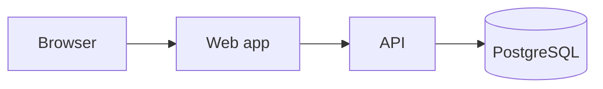

# LabSafe design doc

Implements [PRD](../prd/PRD.md). Every section traces to PRD requirement IDs; nothing speculative.

## 1. Architecture



## 2. Repo layout and layers

## 3. Domain model and invariants

```mermaid
erDiagram
```

| Invariant | Requirement | Enforced by (constraint / transaction / guard) |
| --------- | ----------- | ---------------------------------------------- |

## 4. API surface

| Module | Method | Path | Auth | Purpose | Requirement |
| ------ | ------ | ---- | ---- | ------- | ----------- |

## 5. Auth and authorisation

## 6. Critical flows

```mermaid
sequenceDiagram
```

## 7. Search · file storage · AI assistant (as the PRD requires)

## 8. Error model

## 9. Testing strategy and the tooling contract

How each command in the root CLAUDE.md tooling contract is met; which test level owns what.

## 10. Environments, ports, configuration

## 11. Risks

## 12. Decisions

Project-wide technical choices that are expensive to undo later. Decisions that matter for only one epic go in that epic's `design.md`.

| #   | Decision | Why | Alternatives considered | Date |
| --- | -------- | --- | ----------------------- | ---- |

## 13. Changes
