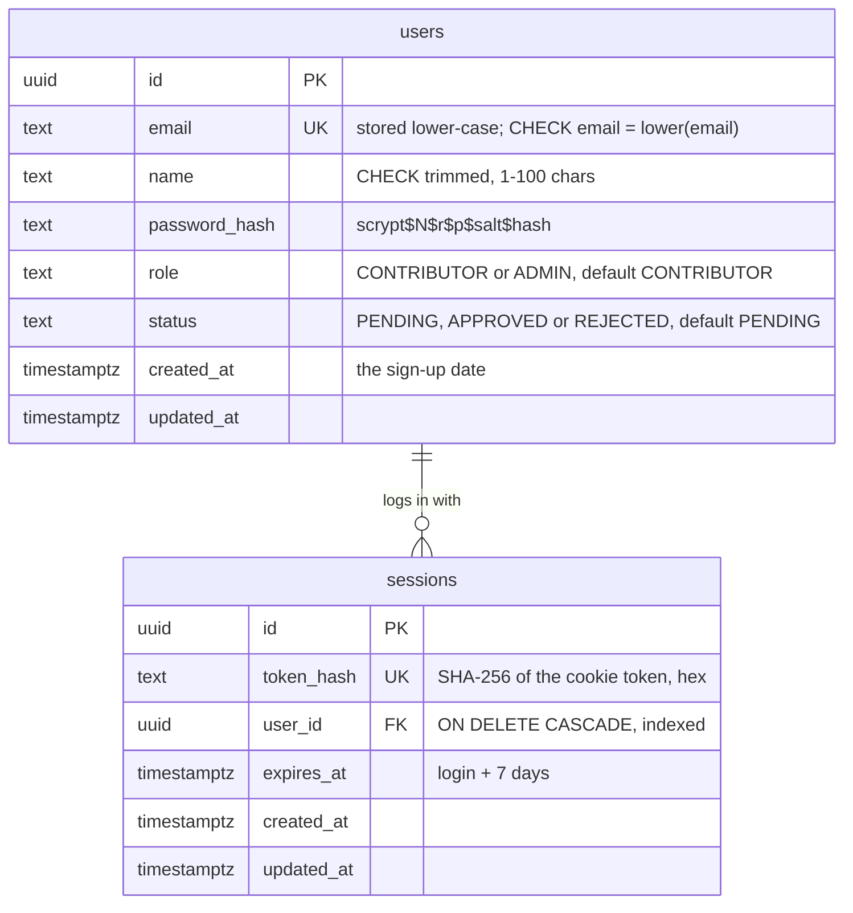
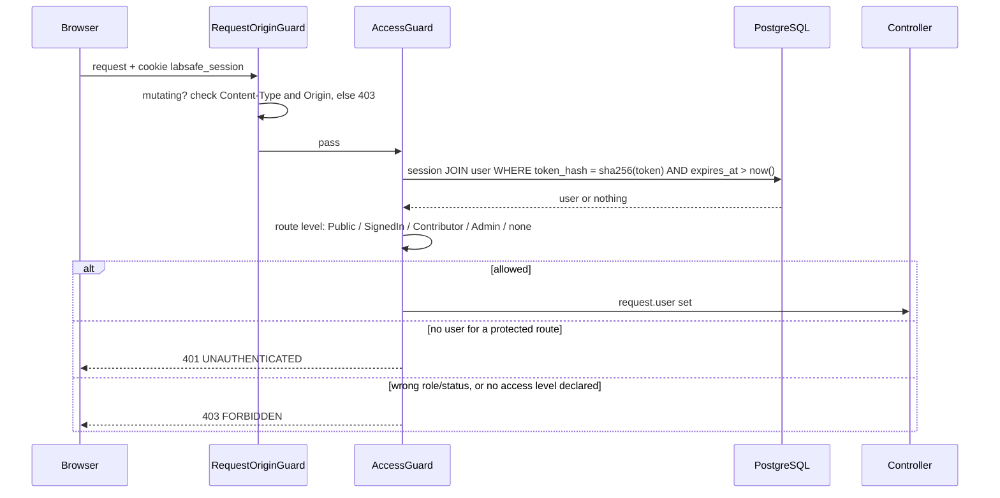

# E02 technical design

**Covers:** US6, US10, US14, NFR4, NFR5 · **Depends on:** E01 · Builds on design doc §3 (I7, I8), §4, §5, §8 and decisions D5, D6, D7. Requirements and rules: [epic.md](epic.md).

## Data



One migration, `CreateUsersAndSessions`. The `users` columns are exactly the NFR5 list plus the two timestamps (the sign-up date is needed for C3). Indexes: `users_email_key`, `sessions_token_hash_key` and `sessions_user_id_idx`. `users.role` and `users.status` are used in `WHERE` but are deliberately **not indexed**: two or three values on about 100 rows (PRD), so PostgreSQL scans the table anyway. This is a recorded exception to the index rule in `apps/api/CLAUDE.md`; add an index if the table grows.

| Rule (epic.md "Rules") | Enforced by |
| --- | --- |
| Email unique regardless of letter case | The shared schema trims and lower-cases the email; `UNIQUE (email)` + `CHECK (email = lower(email))`. A unique violation on sign-up becomes 409 `EMAIL_TAKEN` (no racy pre-check) |
| New account is a pending contributor; nobody picks their role | Column defaults; `SignUpRequest` has no role or status field, so extra keys are stripped |
| Role and status only from the fixed values | `CHECK (… IN …)`: the entity builds it from the shared `ROLES` and `ACCOUNT_STATUSES` constants (I5 pattern); the generated migration holds the values as literals, and `accounts-tables.int.test.ts` keeps the two equal |
| An admin is always an approved account | `CHECK (role <> 'ADMIN' OR status = 'APPROVED')` |
| Approve or reject only a pending sign-up; rejection is final | One conditional `UPDATE … WHERE id = $1 AND status = 'PENDING'`; no row updated → 409 `USER_NOT_PENDING`. No endpoint ever sets a REJECTED account to anything else |
| Promote only an approved account | Role change only `WHERE status = 'APPROVED'`; otherwise 409 `USER_NOT_APPROVED` |
| At least one admin, also under concurrency (I7) | `changeRole` transaction: `SELECT id FROM users WHERE role = 'ADMIN' FOR UPDATE`, then refuse demoting the only one with 409 `LAST_ADMIN` |
| A change takes effect at the next request (I8) | `AccessGuard` loads session and user in one join on every request; nothing about role or status is cached or put in the cookie |
| Password stored only as a hash | `common/password.ts`: `crypto.scrypt` N=2^17, r=8, p=1, 16-byte random salt, 64-byte key, `timingSafeEqual`. Responses are built by `toCurrentUserResponse` / `toAdminUserResponse`, which have no hash field |
| Same login message for unknown email and wrong password | `AuthService.login` verifies against a fixed dummy hash when the email is unknown, so both paths cost one scrypt, then throws the same 401 `INVALID_CREDENTIALS` |
| Sign-up creates user and session together | One transaction |

## Endpoints

All under `/api`. Schemas live in `packages/shared/src/schemas/auth.ts` and `admin-users.ts`. Refusal codes: no or expired session → 401 `UNAUTHENTICATED`; signed in without the right role or status → 403 `FORBIDDEN`.

| Method | Path | Who may call | Request → Response | Errors |
| --- | --- | --- | --- | --- |
| POST | /auth/signup | Public | `SignUpRequest {name, email, password}` → 201 `CurrentUser`, sets the cookie | 400, 409 `EMAIL_TAKEN` (with `fields: email`) |
| POST | /auth/login | Public | `LoginRequest {email, password}` → 200 `CurrentUser`, sets the cookie | 400, 401 `INVALID_CREDENTIALS` |
| POST | /auth/logout | Signed-in | `{}` → 204, deletes the session, clears the cookie | 401 |
| GET | /auth/me | Public | none → 200 `SessionResponse {user: CurrentUser \| null}` | none |
| GET | /admin/users?status= | Admin | `AdminUsersQuery {status: PENDING (S02.2) \| APPROVED (S02.3)}` → `AdminUserList {users: AdminUser[]}` | 400, 401, 403 |
| POST | /admin/users/:id/approve | Admin | `UserIdParam` → 200 `AdminUser` | 400, 401, 403, 404, 409 `USER_NOT_PENDING` |
| POST | /admin/users/:id/reject | Admin | `UserIdParam` → 200 `AdminUser` | 400, 401, 403, 404, 409 `USER_NOT_PENDING` |
| PUT | /admin/users/:id/role | Admin | `ChangeRoleRequest {role}` → 200 `AdminUser` | 400, 401, 403, 404, 409 `USER_NOT_APPROVED` · `LAST_ADMIN` |

`CurrentUser {id, name, email, role, status}` · `AdminUser {id, name, email, role, status, createdAt}`. PENDING lists oldest first; APPROVED lists by name, then email. No paging (PRD: about 100 people at most).

**Session cookie** `labsafe_session`: 32 random bytes (base64url), `HttpOnly`, `SameSite=Lax`, `Path=/`, `Max-Age` 7 days (absolute, not sliding), `Secure` when `COOKIE_SECURE` (default: true only when `NODE_ENV=production`). Set only by sign-up and login; cleared by logout and by `GET /auth/me` when the cookie is unknown or expired. Login, in one transaction, also deletes the user's expired sessions and the request's old session. Cookies are read with `cookie-parser`, registered in `configureApp` so tests run the same set-up.

**Cross-site requests** (design doc §5): a global `RequestOriginGuard` refuses POST, PUT, PATCH and DELETE with 403 `FORBIDDEN` unless the `Content-Type` is `application/json` or `multipart/form-data` and, when an `Origin` header is present, its host equals the `Host` header. The web client sends `application/json` with `{}` on body-less actions. It is registered in `AppModule` and `AccessGuard` in `AuthModule`; Nest runs the root module's global guards first, and a test proves the order (403, not 401). The `pnpm dev` proxy keeps `Host` (`changeOrigin: false`), otherwise every POST would be refused.

## Flows



```mermaid
sequenceDiagram
  participant A1 as Admin A (demotes B)
  participant A2 as Admin B (demotes A)
  participant DB as PostgreSQL
  A1->>DB: BEGIN; SELECT admins FOR UPDATE → {A, B}
  A2->>DB: BEGIN; SELECT admins FOR UPDATE (waits)
  A1->>DB: UPDATE B → CONTRIBUTOR; COMMIT
  DB-->>A2: lock granted, rows re-checked → {A}
  A2->>A2: target A is the only admin → ROLLBACK, 409 LAST_ADMIN
```

**First admin** (design doc §5): at start-up, `BootstrapAdminService` checks, in one transaction, whether any ADMIN exists. If not, and `BOOTSTRAP_ADMIN_EMAIL`, `BOOTSTRAP_ADMIN_PASSWORD` and `BOOTSTRAP_ADMIN_NAME` are set, it creates that account as APPROVED ADMIN, or, if the email already has an account (whatever its status), makes it an approved admin and keeps its name and password. The three settings are **all or none**: a partial set stops the start-up with one line naming the missing ones; with none set and no admin it logs a warning. Each is checked with the sign-up rules (`Email`, password 8–128, name 1–100). `AppConfig` holds them as one `BOOTSTRAP_ADMIN` object, so a partial set cannot reach the service. Only these names are read; older `SEED_ADMIN_*` names in a `.env` are ignored. `e2e/test-env.ts` sets test values so `pnpm e2e` and `pnpm qa:serve` start with an admin.

## Screens

One layout route, `RequireAccount` (level `contributor` or `admin`), wraps every protected page and decides from `useMe()` at the same URL: loading, log in, waiting, not approved, no access, or the page.

| Route | Who sees it | Loading | Empty | Error | Success |
| --- | --- | --- | --- | --- | --- |
| header (every page) | everyone | nothing account-related yet | anonymous: "Log in" link | `me` failed: "Log in" link | name, role links ("Contributor area"; admins also "Sign-ups", "Accounts"), "Log out" |
| `/signup` | anonymous (signed-in → `/contribute`) | button "Signing up…", disabled | — | field errors; `alert` "Something went wrong, try again." | → `/contribute` (shows the waiting notice) |
| `/login` | anonymous (signed-in → `/contribute`) | button "Logging in…", disabled | — | field errors; `alert` "Email or password is wrong"; `alert` "Something went wrong, try again." | → `next` (local paths only) or `/contribute` |
| `/contribute` | approved contributor, admin | `status` "Loading…" | the empty area: h1 "Contributor area" | `alert` "Couldn't load, try again." + Retry | h1 "Contributor area" |
| `/admin/sign-ups` | admin | `status` "Loading…" | "No pending sign-ups" | `alert` + Retry; action errors as `alert` | pending rows: name, email, sign-up date, Approve, Reject (with a confirm step) |
| `/admin/accounts` | admin | `status` "Loading…" | none (there is always an admin) | `alert` + Retry; "There must be at least one admin." | approved rows: name, email, role in words, "Make admin" or "Remove admin" |

Gate outcomes: anonymous → `/login?next=<path>`; PENDING → h1 "Waiting for approval", "Your account is waiting for approval."; REJECTED → h1 "Sign-up not approved", "Your sign-up was not approved."; contributor on an admin page → h1 "No access", "You don't have access to this page.". Any 401 or 403 from an action invalidates `['auth', 'me']`, so the gate re-decides. Forms use react-hook-form (D8) with the shared schemas.

## Who may do what

| Endpoint or screen | anonymous | pending | rejected | contributor | admin |
| --- | --- | --- | --- | --- | --- |
| POST /auth/signup, POST /auth/login, GET /auth/me | ✓ | ✓ | ✓ | ✓ | ✓ |
| POST /auth/logout | ✗ 401 | ✓ | ✓ | ✓ | ✓ |
| GET /admin/users, POST …/approve, POST …/reject, PUT …/role | ✗ 401 | ✗ 403 | ✗ 403 | ✗ 403 | ✓ |
| any route without an access level | ✗ 403 | ✗ 403 | ✗ 403 | ✗ 403 | ✗ 403 |
| `/contribute` | → log in | waiting | not approved | ✓ | ✓ |
| `/admin/sign-ups`, `/admin/accounts` | → log in | waiting | not approved | no access | ✓ |

## Decisions

| # | Decision | Why | Options considered |
| --- | --- | --- | --- |
| E02-D1 | Emails are lower-cased by the shared schema and stored that way; `UNIQUE` + `CHECK (email = lower(email))` | Case-insensitive uniqueness with plain constraints the entity can mirror; no extension | `citext` (needs `CREATE EXTENSION`); unique index on `lower(email)` (TypeORM cannot mirror it) |
| E02-D2 | One global `AccessGuard` with four levels (`@Public`, `@SignedIn`, `@Contributor`, `@Admin`); a route without one is refused | Deny by default in one place; one query per request gives I8 | A guard per controller (easy to forget) |
| E02-D3 | `GET /auth/me` is Public and answers `{user: null}` when anonymous | Every page asks it; students would otherwise get a 401 on every visit | Signed-in with 401 (the old design doc §4, updated 2026-11-24) |
| E02-D4 | Sign-up signs the person in at once; PENDING and REJECTED accounts can log in | C1 and C4 need them to see their status; the server refuses by role, not by login | Refusing login until approved (no way to show the status) |
| E02-D5 | Status and role changes are conditional single-row updates; demotion locks the admin rows | Two admins acting at once can't double-handle a sign-up or remove the last admin | Read-then-write in the service (racy); a counter table |
| E02-D6 | scrypt N=2^17, r=8, p=1, stored as `scrypt$N$r$p$salt$hash` | OWASP's scrypt minimum; the parameters travel with the hash, so they can change later | Lower cost (weaker); argon2 (native build, D6) |
| E02-D7 | The web gate is one layout route that renders the status notice at the requested URL | One place for C1, C4 and C9; a typed URL can't skip it | Separate `/waiting` and `/no-access` routes with redirects |

New error codes in `packages/shared/src/errors.ts`: `UNAUTHENTICATED`, `FORBIDDEN`, `INVALID_CREDENTIALS`, `EMAIL_TAKEN`, `USER_NOT_PENDING`, `USER_NOT_APPROVED`, `LAST_ADMIN`. New dependencies (minor versions, no upgrades): `cookie-parser` (api), `react-hook-form` and `@hookform/resolvers` (web).

## Risks

- **Password guessing.** No login rate limit (the PRD does not ask for one). The scrypt cost slows each guess, and a new account still needs an admin. Raise a `/change-request` if needed.
- **The sign-up message reveals that an email is registered** (epic open question 4, accepted).
- **scrypt is slow in tests.** Test helpers create users with one precomputed hash; only the hashing tests run scrypt many times.
- **Entity and migration drift.** Each new entity gets the schema-builder check used in `apps/api/test/meta.int.test.ts` (no pending query).
- **Supertest sends no `Origin`.** Allowed by design; the origin tests set one explicitly.
- **e2e tests share one database** across both browser widths: every test uses its own unique email.
- **First sign-up with the bootstrap email** (S02.2 review F3). While no admin exists, whoever signs up first with the address later put in `BOOTSTRAP_ADMIN_EMAIL` becomes admin at the next start with their own password, even a REJECTED account; there is no email verification. Mitigation: set the three `BOOTSTRAP_ADMIN_*` settings before the first public start (E08).
- **`.env.example` has the three settings active with a placeholder password** (S02.2 review F2, left open). Copying it gives the development database an admin with a public password; production takes its settings from Render, never from this file.
- **A promotion and a self-demotion at the same moment** (S02.3 review F1). Under READ COMMITTED the locked admin rows are those that were admins when the demotion's `SELECT … FOR UPDATE` started, so it can wrongly answer 409 `LAST_ADMIN`. Accepted: it only fails safe (no admin is lost) and a retry succeeds.

## Stories

1. [S02.1 Sign up, log in and log out](S02.1-signup-login/story.md) · delivers C1, C2, C5, C9, C11, C12, C13, C14 · depends on: none
2. [S02.2 Approve or reject sign-ups](S02.2-approve-signups/story.md) · delivers C1, C3, C4, C6, C9, C10, C13, C14 · depends on: S02.1
3. [S02.3 Share the admin role](S02.3-admin-roles/story.md) · delivers C7, C8, C10, C13, C14 · depends on: S02.2

## Open questions

1. **`GET /auth/me` for anonymous visitors.** Chosen: Public, `{user: null}` (E02-D3). Design doc §4 updated on 2026-11-24 (`/complete-epic`).
2. **The bootstrap email already has an account but no admin exists.** Chosen: make that account an approved admin, password unchanged. The risk this opens is under "Risks".
3. **Login rate limiting.** Chosen: not built (not in the PRD); listed under Risks.
4. **Rejecting is final, so is there a confirm step?** Chosen: yes, an inline "Yes, reject" / "Cancel" step. Promote and demote can be undone, so they have none.
5. **Session lifetime.** Chosen: a fixed 7 days from login, not extended by use (design doc §5).
6. **`created_at` and `updated_at` on `users` go beyond the NFR5 list.** Chosen: keep them; they hold no personal data and C3 needs the sign-up date.

## Changes

- 2026-11-24 · `/complete-epic` (S02.2 review F1, F2, F3; S02.3 review F1; build report): "Data" records that `users.role` and `users.status` are deliberately not indexed and that the migration holds the CHECK values as literals; "Endpoints" adds login's session clean-up, the guard order and the dev proxy; E02-D3 and open questions 1 and 2 point at the updated design doc and the new risk; "First admin" names all three `BOOTSTRAP_ADMIN_*` settings, says all three or none, and that `SEED_ADMIN_*` is not read; "Risks" adds the first sign-up with the bootstrap email, the `.env.example` placeholder password and the false `LAST_ADMIN` refusal under a concurrent promotion.
