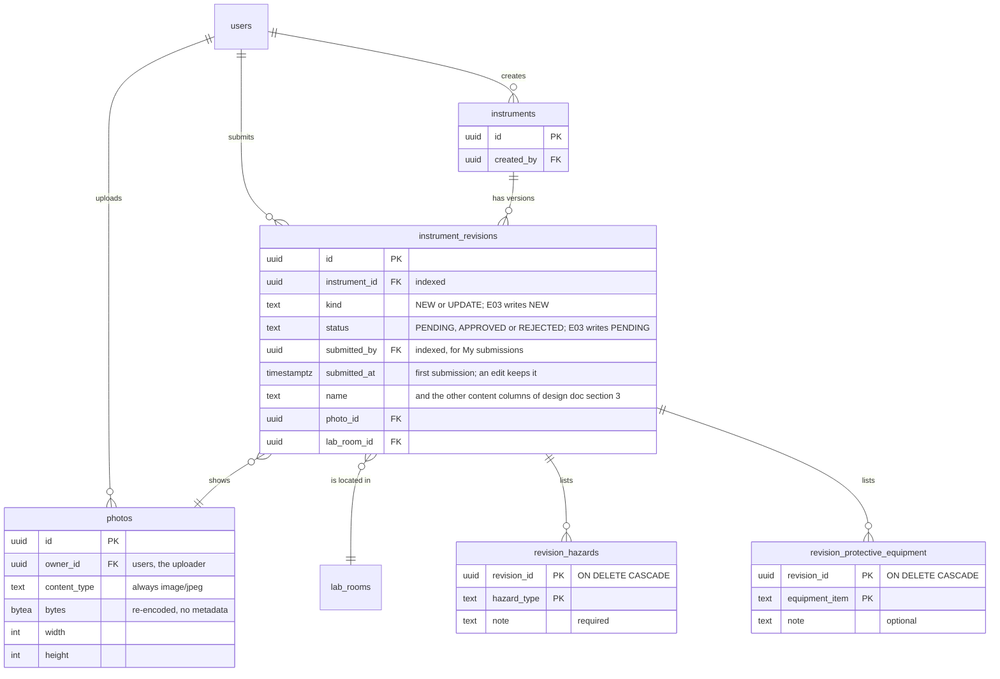

# E03 technical design

**Covers:** US7, R3, R4, R5, plus the "someone else's draft" part of NFR4 and the "cannot create pages" part of US6 · **Depends on:** E02 · Builds on design doc §3 (I4, I5, I6, I8, I9, I11), §4, §7 "Photos", §8 and decisions D2, D3, D10, D15. Requirements and rules: [epic.md](epic.md).

## Data



One migration, `CreateSafetyPageTables`, creates the five tables with the content columns of design doc §3 (`manufacturer`, `model`, `training_given_by` nullable; `hazard_pictograms text[]`; `emergency_equipment jsonb`). Every table except the two child tables has `created_at` and `updated_at`. The tables hold only what E03 writes (decision E03-D6): E04 adds `slug`, `published_revision_id` (I2), `reviewed_by`, `reviewed_at`, `review_note`; E05 adds `deleted_at` and the I3 index; E06 and E07 add `search_vector` (design doc §3) and the search indexes. `photos` also has `CHECK (content_type = 'image/jpeg')` and `CHECK (width > 0 AND height > 0)`. The CHECK lists are built with `src/db/sql-list.ts` (`sqlList`, `valuesOf`), which `user.entity.ts` now uses too. There is no instruments module: `SubmissionsModule` registers the four entities of `src/modules/instruments/` (and `LabRoom`) with `forFeature`.

| Rule (epic.md "Rules") | Enforced by |
| --- | --- |
| Every required field present; spaces only count as missing (R3, I4) | Shared `SafetyPageContent` schema trims every text and names **every** problem in one 400 (cross-field rules run even when other fields fail, E03-D2). Database: `NOT NULL` and `CHECK (btrim(x) <> '')` on every required text column; optional texts are null or non-empty |
| Hazards: one or more with a note, or "No significant hazards", not both, not neither | Schema rule. The service writes the revision and its rows in one transaction from the parsed body only, so nothing else can break it. `revision_hazards.note` has a non-empty CHECK |
| PPE: one or more, or "No PPE beyond standard lab attire", not both, not neither | The same, with `standard_lab_attire_only` and `revision_protective_equipment` |
| Training required ⇒ "who gives it"; not required ⇒ not stored | Schema; `CHECK ((training_required AND training_given_by IS NOT NULL AND btrim(training_given_by) <> '') OR (NOT training_required AND training_given_by IS NULL))` (without `IS NOT NULL`, a NULL trainer would make the CHECK NULL and pass) |
| Training required ⇒ not LOW (R5, I6) | Schema rule on `hazardLevel`; `CHECK (NOT (training_required AND hazard_level = 'LOW'))` |
| Fixed lists only (R4, I5) | Zod enums built from the `lists.ts` constants; CHECKs `IN (…)` on category, hazard level, kind, status, hazard type, PPE item, and `hazard_pictograms <@ ARRAY[…]`, built by the entities from the same constants (the `user.entity.ts` pattern) |
| Lab rooms only from the initial data | `lab_room_id` foreign key; the service checks the room first and answers 400 with `fields: labRoomId` |
| Six emergency items, each a location or "not applicable" | Schema (a discriminated object per item); `CHECK (jsonb_typeof(emergency_equipment) = 'object' AND emergency_equipment ?& ARRAY[six keys])` |
| The photo is the submitter's own upload | Service check inside the transaction; otherwise 400 with `fields: photoId` |
| Photo: JPEG or PNG by content, ≤ 5 MB, no metadata (NFR5) | Multer limit 5,242,880 bytes → 413 (`photo-upload-errors.interceptor.ts` gives it the code `PHOTO_TOO_LARGE`); `sharp` decides the format from the bytes → 415; every photo is re-encoded (E03-D8) |
| A pending page and its photo: only the author and admins read it | Service visibility check returning 404 (E03-D4, I9, I11) |
| Only the author edits; still pending afterwards | `PUT` transaction loads `WHERE id = $1 AND submitted_by = me AND status = 'PENDING' FOR UPDATE`; no row → 404 |

Child rows use the design doc's composite keys and have no id or timestamps of their own: they are replaced together with their revision. This is a recorded exception to the entity rule in `apps/api/CLAUDE.md`. Each new entity mirrors the migration, with the schema-builder check from `meta.int.test.ts`.

## Endpoints

All under `/api`. Schemas in `packages/shared/src/schemas/safety-page.ts`, `photos.ts` and `submissions.ts`; the exact fields and messages are in the stories' "API contract". New error codes `PHOTO_TOO_LARGE`, `PHOTO_TYPE` (design doc §8).

| Method | Path | Who may call | Request → Response | Errors |
| --- | --- | --- | --- | --- |
| POST | /photos | Contributor | multipart, one file in field `photo` → 201 `Photo {id, width, height}` | 400 (no file, a file in another field, or a second file), 401, 403, 413 `PHOTO_TOO_LARGE`, 415 `PHOTO_TYPE` |
| GET | /photos/:id | Public guard; owner or admin (service) | → 200 `image/jpeg`, `Cache-Control: private, no-cache`, `X-Content-Type-Options: nosniff` | 400 malformed id, 404 for everyone else |
| POST | /submissions | Contributor | `SafetyPageContent` → 201 `Submission` | 400 `VALIDATION_FAILED` with every field, 401, 403 |
| GET | /submissions/mine | Contributor | → 200 `MySubmissions {submissions: SubmissionSummary[]}`, newest first | 401, 403 |
| GET | /submissions/:id | Public guard; author or admin (service) | `SubmissionIdParam` → 200 `Submission` | 400 malformed id, 404 for everyone else (an author no longer approved included) |
| PUT | /submissions/:id | Public guard; author only (service) | `SafetyPageContent` → 200 `Submission` | 400, 403 (origin check), 404 for everyone else (admins included) and for a revision no longer `PENDING` |

`Submission {id, kind, status, submittedAt, updatedAt, submittedBy {id, name}, content: SafetyPageContent}` · `SubmissionSummary {id, name, status, submittedAt}`. `GET /submissions/mine` is declared before `/:id`, and each handler declares its own access level (no class-level decorator). Hazards and PPE items come back in PRD §4.2 order (the rows have no order column). Design doc §4 records E03-D4. No paging (about 100 instruments). The public page address `/instruments/<slug>` doesn't exist yet: the web catch-all and the unknown API route both answer "not found" (C10); E04 builds it.

## Flows

```mermaid
sequenceDiagram
  participant B as Browser (form)
  participant P as PhotosService
  participant S as SubmissionsService
  participant DB as PostgreSQL
  B->>P: POST /photos (multipart, ≤ 5 MB, guards first)
  P->>P: sharp: format from bytes is jpeg/png, else 415; rotate, fit 1600 px, flatten, JPEG, no metadata
  P->>DB: INSERT photos (owner = me)
  P-->>B: 201 Photo {id}
  B->>B: shared schema check, error summary if anything is missing
  B->>S: POST /submissions SafetyPageContent {photoId, …}
  S->>S: ZodValidationPipe: every missing or invalid field at once, else 400
  S->>DB: BEGIN; lab room exists? photo owned by me? (else 400 fields)
  S->>DB: INSERT instruments, instrument_revisions (NEW, PENDING), hazards, PPE; COMMIT
  S-->>B: 201 Submission
  B->>B: go to /contribute, status message, My submissions refetched
```

An edit (`PUT`) runs the same checks, then in one transaction locks the revision, updates its content and replaces its hazard and PPE rows. `submitted_at` keeps the first submission date.

## Screens

All under `RequireAccount level="contributor"` (E02-D7). The form is one component, `SafetyPageForm` in `src/components/safety-page-form/`, used by the new and the edit page. Its groups: Identity, Risk at a glance, Hazards and protection, Guidelines, Emergency info.

| Route | Who sees it | Loading | Empty | Error | Success |
| --- | --- | --- | --- | --- | --- |
| `/contribute` | approved contributor, admin | My submissions: `status` "Loading your submissions…" | "You haven't submitted any pages yet." | `alert` "Couldn't load your submissions, try again." + Retry | link "New safety page"; rows: name (a link to its edit page), "Submitted <date>", "Status: Pending"; the confirmation as `status` |
| `/contribute/new` | approved contributor, admin | `status` "Loading…" (lists) | the empty form | lists: `alert` + Retry; submit: error summary `alert`, field messages, network/500/401/403 `alert`, form kept | → `/contribute` with "<name> was submitted and is waiting for review." |
| `/contribute/submissions/:id` | the author | `status` "Loading…" until the submission and the lists have loaded | — | not yours, unknown or malformed: h1 "Page not found" (a malformed id sends no request; a 404 shows after the one default retry, about 1 s); load: `alert` + Retry; save errors as above | → `/contribute` with "Your changes to <name> were saved. It is still waiting for review." |
| photo field (both forms) | as the form | "Uploading photo…" | "JPEG or PNG, at most 5 MB" | the 5 MB or type message next to the field | preview of the stored photo + "Change photo" |

A failed **background** refresh never replaces a form that is already shown, in the gate, the header (S02.1 F4) or the edit page's own query (E03-D7). The R5 definitions, the guideline prompts and the field labels are web constants; GHS symbols are SVG files in `apps/web/src/assets/ghs/`, shown inside the checkbox label next to the name (decorative, `alt=""`, the label names it).

## Who may do what

| Endpoint or screen | anonymous | pending, rejected | author | other approved contributor | admin, not the author |
| --- | --- | --- | --- | --- | --- |
| POST /photos, POST /submissions | ✗ 401 | ✗ 403 | ✓ | ✓ | ✓ |
| GET /submissions/mine | ✗ 401 | ✗ 403 | ✓ own | ✓ own | ✓ own |
| GET /photos/:id (photo not yet published) | ✗ 404 | ✗ 404 | ✓ owner | ✗ 404 | ✓ |
| GET /submissions/:id | ✗ 404 | ✗ 404 | ✓ | ✗ 404 | ✓ |
| PUT /submissions/:id | ✗ 404 | ✗ 404 | ✓ | ✗ 404 | ✗ 404 |
| `/contribute`, `/contribute/new` | → log in | notice | ✓ | ✓ | ✓ |
| `/contribute/submissions/:id` | → log in | notice | ✓ | "Page not found" | "Page not found" |

## Decisions

| # | Decision | Why | Options considered |
| --- | --- | --- | --- |
| E03-D1 | The photo is uploaded on its own (`POST /photos`) as soon as it is chosen; the page refers to it by `photoId` | The page stays one JSON body checked by one shared schema; size and type errors show at once with a preview | One multipart request with the page and the file |
| E03-D2 | One `SafetyPageContent` schema for create and edit, in the browser and on the server; its cross-field rules run even when other fields fail | R3's "every missing field at once" from one source; the form and the API can't drift (D2) | Separate client and server rules |
| E03-D3 | The public address (slug) is assigned at first approval in E04, not at submission | A pending or rejected page can still be renamed; no address is reserved for a page that is never approved. Once set it never changes (design doc §3) | Slug at submission, frozen even if the name is fixed |
| E03-D4 | Reading or editing one submission or photo is `@Public()` at the guard and decided by the service, which answers 404 to everyone it doesn't allow | The epic wants "not found" also for anonymous, pending and rejected callers; one 404 for "missing" and "not yours" reveals nothing (R1, I9) | `@Contributor()` (401/403 first, then 404) |
| E03-D5 | An edit replaces the content and the hazard and PPE rows in one transaction that locks the revision row | Two saves at once can't interleave; the stored page is always one complete submission | Diffing child rows |
| E03-D6 | E03's tables hold only the columns E03 writes; later epics add theirs | Nothing unused is built; each epic's migration matches its rules | The whole design doc schema now |
| E03-D7 | The web keeps cached data when a background refresh fails; submit and upload send at once even offline (TanStack `networkMode: 'always'`) and fail with a message; a 401 on submit doesn't refresh `me` | The typed page is never thrown away (C15, epic open question 9); TanStack would otherwise pause an offline mutation silently | Draft autosave (out of scope) |
| E03-D8 | Every photo is re-encoded to JPEG: auto-rotated, at most 1600 px on its longer side, never enlarged, transparency flattened on white, quality 80, no metadata | Removes GPS and camera data (NFR5) and keeps photos around 300 KB (D10); the content decides the type | Keep PNGs as PNG; strip EXIF only |

New dependencies (current versions, no major upgrades): `sharp` ^0.35.5 in the API (approved in `allowBuilds:` of `pnpm-workspace.yaml`), `@types/multer` ^2.3.0 (dev). Multer already comes with `@nestjs/platform-express`.

## Risks

- **Multer's size error becomes a generic 413.** Nest turns `LIMIT_FILE_SIZE` into a `PayloadTooLargeException`, which the error filter would answer as `REQUEST_REJECTED`. Built: `photo-upload-errors.interceptor.ts` on `POST /photos` only maps it to `PHOTO_TOO_LARGE` (the body parser's 413 stays `REQUEST_REJECTED`), and a test proves the code and message.
- **The JSON body limit (100 KB by default).** The text limits in the contract keep the largest possible page at about 26,000 characters, well below it even with 3-byte characters.
- **Cross-field rules on partial data.** With `when`, a rule also sees invalid input; it must not throw on missing fields (pattern: `apps/api/src/common/config.ts`).
- **`sharp` is native** (design doc §11). Prebuilt binaries for macOS and Linux; approve its build in `allowBuilds:`.
- **Unsubmitted photos stay stored** (epic open question 8). Only the owner and admins can read them; no clean-up.
- **The session ends while writing** (epic open question 9). A submit then gets the "log in again in another tab" message and the form stays. A focus refresh that answers `{user: null}` still sends the person to log in, which loses the form; rare with 7-day sessions.
- **e2e tests share one database** at both widths: each test uses its own accounts; page names may repeat (epic open question 5).

## Stories

1. [S03.1 Write and submit a new safety page](S03.1-write-submit-page/story.md) · delivers C1–C8, C10, C11 (photo), C12, C13, C14, C15 (offline submit), C16, C17 · depends on: none
2. [S03.2 Correct my pending page; nobody else can](S03.2-edit-pending-page/story.md) · delivers C9, C11, C13 (edit), C16 (edit form), C17 · depends on: S03.1
3. [S03.3 Keep my work when the connection drops](S03.3-keep-work-offline/story.md) · delivers C15, C17 · depends on: S03.1

## Open questions

1. **Admin calling `PUT` on someone else's pending page.** Chosen: 404, like every other caller (I9's single query), not 403. The admin never sees an edit button.
2. **When is the public address set?** Chosen: at first approval in E04 (E03-D3). Recorded in design doc §3.
3. **Text limits (epic open question 7).** Chosen: name, manufacturer, model 120; description 500; responsible name 100; contact, "who gives the training", PPE note and each equipment location 200; hazard note 300; each guideline section 4,000; emergency phone 50 characters.
4. **GHS symbol images.** Chosen: the nine official UNECE pictogram SVGs, built as the public-domain files from Wikimedia Commons in `apps/web/src/assets/ghs/`, with their source in `ghs-symbols.ts`. If the user doubts the licence, deleting the folder leaves the names only.
5. **An invalid body from a stranger on `PUT`.** Chosen: 400 from the validation pipe, before the 404 check. It is the same answer for any id, so it reveals nothing about the page.
6. **Ticking a hazard and "No significant hazards" (or the PPE pair) together.** Chosen: the form allows it and refuses it on submit with a message, so C5 can be seen and the rule lives in one place.
7. **An unknown lab room or someone else's photo.** Chosen: reported by the service after the schema checks pass, so in a second round. The form only offers real rooms and the person's own upload, so only direct API calls see this.
8. **"Submitted" date after an edit.** Chosen: it stays the first submission date; `updatedAt` holds the last save.

## Changes

- 2026-11-25 · `/complete-epic` (S03.1 review F3, the tickets' implementation notes): "Data" gives the training CHECK with `IS NOT NULL`, the `emergency_equipment` `jsonb_typeof` check, the two `photos` CHECKs, `sql-list.ts`, the entities registered by `SubmissionsModule`, and `search_vector` left to E06/E07. "Endpoints" adds the 400 for a file in another field or a second file, the 403 origin check and 404 for a non-pending revision on `PUT`, the 404 for an author who is no longer approved, per-handler access levels and the PRD order of hazards and PPE. "Screens" adds the name link, the lists load on the edit page and the one-retry delay before "Page not found". The dependency versions, the size-error interceptor under "Risks", and open questions 2 and 4 (GHS SVGs from Wikimedia Commons) now say what was built.
