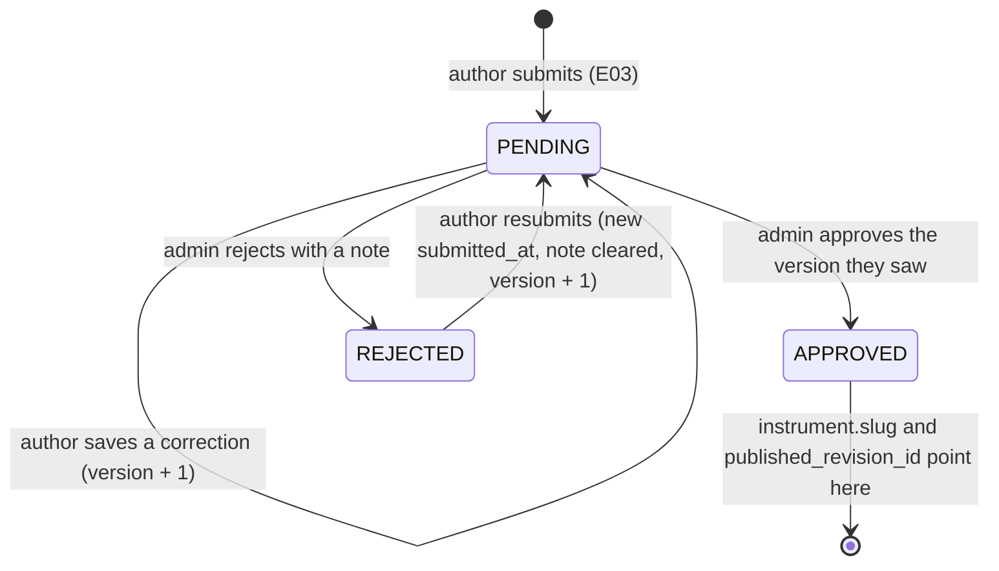
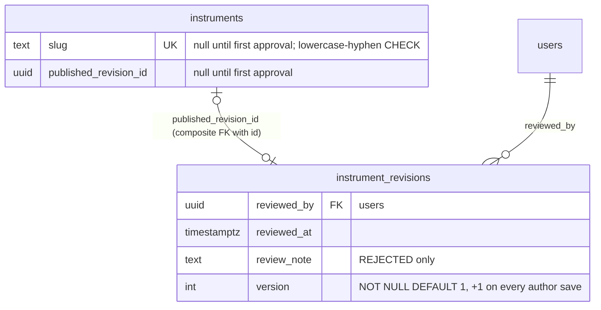

# E04 technical design

| **Author** | architect |
| --- | --- |
| **Status** | see `status:` above |
| **Date** | 2026-11-25 |
| **Reviewer** | the user (approves by running `/build-epic`) |

## Objective

Give admins one list of pending pages, a preview identical to the public page, and Approve or Reject with a note. Approving publishes a page at its own public address, readable by anyone on a phone. The author sees the outcome and can fix and resubmit a rejected page. Nothing unapproved leaks (R1, M3), and E03's three known form gaps are closed.

## Background

E02 built accounts, sessions and the `AccessGuard` levels. E03 built `photos`, `instruments`, `instrument_revisions` and the two child tables, plus the shared `SafetyPageContent`, `SafetyPageForm`, the new-page and edit pages and "My submissions". E03 wrote only `PENDING` revisions and left `slug`, `published_revision_id` and the review columns to E04 (E03-D3, E03-D6). `GET`/`PUT /submissions/:id` and `GET /photos/:id` are `@Public()` at the guard and answer 404 from the service (E03-D4). The public address `/instruments/<slug>` does not exist yet. The design doc fixes the revision model (D3), invariants I1, I2, I9 and I11, and one `SafetyPageView` for the preview and the public page (§2).

## Requirements

US3, US4, US9, US11, US12, R1, and the E04 part of NFR4 and M3. Criteria C1–C20 and the eight open questions with the chosen options: [epic.md](epic.md).

## Design

A revision's life. The instrument's pointer moves only when a revision is approved:



Approving, the one flow with several steps:

```mermaid
sequenceDiagram
  participant A as Admin's browser
  participant R as ReviewService
  participant DB as PostgreSQL
  A->>R: GET /admin/submissions/:id
  R-->>A: ReviewSubmission {version: 3, page}
  A->>R: POST /admin/submissions/:id/approve {version: 3}
  R->>DB: BEGIN; SELECT revision FOR UPDATE
  alt status is not PENDING
    R-->>A: 409 ALREADY_REVIEWED
  else version is not 3 (the author saved meanwhile)
    R-->>A: 409 SUBMISSION_CHANGED
  else
    R->>DB: SELECT instrument FOR UPDATE
    R->>DB: pg_advisory_xact_lock, pick a free slug (only if the instrument has none)
    R->>DB: UPDATE revision: APPROVED, reviewed_by, reviewed_at
    R->>DB: UPDATE instrument: slug, published_revision_id; COMMIT
    R-->>A: 200 ReviewDecision {slug}
  end
```

## Technical implementation

### Data models

One migration for the whole epic, **`AddReviewAndPublishing`** (S04.2 BE-02), so the user approves one file (E04-D6). It adds only what E04 writes:



Also: `UNIQUE (instrument_id, id)` on `instrument_revisions` (`instrument_revisions_instrument_id_id_key`, the target of the I2 composite foreign key `instruments_published_revision_fkey`, `(id, published_revision_id) → instrument_revisions (instrument_id, id)`, built by TypeORM with no fallback), `instrument_revisions_reviewed_by_fkey`, `instrument_revisions_version_check` (`version >= 1`), and indexes `instrument_revisions_status_submitted_at_idx` for the queue and `instrument_revisions_photo_id_idx` for the photo check. `instruments_slug_check` checks the lowercase-hyphen form with no length limit; `slugify` keeps the part made from the name to 80 characters. Until S04.2 lands, S04.1's queue query runs without its index (recorded exception; about 100 rows). Existing E03 rows are `PENDING` with no review data, so every CHECK holds for them.

| Rule (epic.md "Rules") | Enforced by |
| --- | --- |
| Only an approved admin reviews | `@Admin()` on `AdminReviewController`; refusal tests per role (NFR4) |
| Reviewed once | Approve locks the revision `FOR UPDATE`; reject is one conditional `UPDATE … WHERE id AND status = 'PENDING' RETURNING id` (no row: unknown id 404, else 409). Not `PENDING` (also approving a rejected page) → 409 `ALREADY_REVIEWED`. CHECK `instrument_revisions_review_check`: PENDING has no reviewer, date or note; APPROVED has reviewer and date, no note; REJECTED has all three, note non-empty |
| The admin approves only what they saw (C14) | Approve carries the `version` from the preview; every author save increments it under the same row lock; a mismatch → 409 `SUBMISSION_CHANGED` (E04-D2) |
| Approving publishes at once | One transaction: revision `APPROVED` + reviewer + date, instrument pointer + slug (I2). Composite FK; CHECK `instruments_published_check`: slug and pointer both null or both set |
| A unique public address that never changes | `slugify(name)` and the first free `-2`, `-3`… under `pg_advisory_xact_lock`; unique `instruments_slug_key`; set only while `slug IS NULL` (E04-D3) |
| A rejection needs a note; spaces count as missing | Shared `RejectSubmissionRequest` (trimmed, 1–1,000); the review CHECK |
| The note is never public | It exists only in `Submission`, `SubmissionSummary` (author) and the admin responses; `PublishedSafetyPage` has no such field |
| The public sees only published pages and their photos (R1, I1, I11) | `PublishedInstrumentsQuery`: `slug = $1` joined through `published_revision_id`, and `status = 'APPROVED'` as a second guard; a photo is public only if it is a published revision's photo (E04-D7). Everything else answers the E03-D4 404 |
| Only the author fixes and resubmits | `PUT` locks `id AND submitted_by = me`; PENDING → correction; REJECTED → resubmission (`PENDING`, `submitted_at = now`, review columns cleared, E04-D5); APPROVED → 409 `ALREADY_REVIEWED` to the author (E04-D8); admins and everyone else 404 |
| No contributor name or email, no admin email on the public page | `PublishedSafetyPage` carries only the approver's name |

### API layer

New schemas in `packages/shared/src/schemas/review.ts` and `instruments.ts`; new error codes `ALREADY_REVIEWED`, `SUBMISSION_CHANGED` (409). Exact fields in each story's "API contract". `SafetyPageDisplay {content, labRoom, lastApproved {at, approverName} | null}` is the one shape the view renders (E04-D1).

| Method | Path | Who may call | Request → Response | Errors |
| ------ | ---- | ------------ | ------------------ | ------ |
| GET | /admin/review-queue | Admin | → `ReviewQueue {items}`, oldest `submittedAt` first | 401, 403 |
| GET | /admin/submissions/:id | Admin | → `ReviewSubmission {id, kind, status, version, submittedAt, submittedBy, page}` | 400, 401, 403, 404 |
| POST | /admin/submissions/:id/approve | Admin | `{version}` → `ReviewDecision {id, status, slug}` | 400, 401, 403, 404, 409 `ALREADY_REVIEWED` · `SUBMISSION_CHANGED` |
| POST | /admin/submissions/:id/reject | Admin | `{note}` → `ReviewDecision` | 400 `note`, 401, 403, 404, 409 `ALREADY_REVIEWED` |
| GET | /instruments/:slug | Public | → `PublishedSafetyPage {slug, page}` | 400 (a slug over 200 characters), 404 (also any slug that isn't published) |
| GET | /photos/:id | Public* | as E03, plus: a published page's photo for anyone | 400, 404 |
| GET | /submissions/mine | Contributor | `SubmissionSummary` gains `reviewNote`, `slug` | 401, 403 |
| GET · PUT | /submissions/:id | Public* | `Submission` gains `reviewNote`; `PUT` also resubmits a rejected page | as E03, plus 409 `ALREADY_REVIEWED` (author, approved page) |

New API modules: `review` (the admin controller and `ReviewService`) and `instruments` (now a real module: `InstrumentsController`, `PublishedInstrumentsQuery` exported to `PhotosModule`). The content mapping moves from `submission.response.ts` to `src/modules/instruments/` so that submissions, review and instruments share it. No cycles: instruments ← photos ← submissions; `ReviewModule` imports no feature module, only TypeORM with the instrument entities and the pure `slug.ts`. A public photo keeps E03's `Cache-Control: private, no-cache`.

### UI layer

| Route | Who sees it | Loading | Empty | Error | Success |
| ----- | ----------- | ------- | ----- | ----- | ------- |
| `/admin/review` | admin (header link "Pages to review") | `status` "Loading pages to review…" | "No pages waiting for review." | `alert` + Retry | rows: name link, "New", contributor, date; the approve or reject confirmation |
| `/admin/review/:id` | admin | `status` "Loading…" | — | "Page not found"; load `alert` + Retry; decision `alert`s (409s, network, 401, 403) | contributor, date, Approve, note + Reject, then the `SafetyPageView` |
| `/instruments/:slug` | anyone | `status` "Loading safety page…" | — | "Page not found" (a slug over 200 characters sends no request); `alert` + Retry | `SafetyPageView` |
| `/contribute` | contributor, admin | as E03 | as E03 | as E03 | Pending · Approved (link to the public page) · Rejected (the note; link to the fix form) |
| `/contribute/submissions/:id` | the author | as E03 | — | as E03 | pending: edit (E03); rejected: "Fix safety page", the note, "Resubmit for review"; approved: h1 "Edit safety page", a message and the public link, no form. Edit or fix is chosen once, when the form first shows; a refresh never replaces an open form (E03-D7) |

`SafetyPageView` (`src/components/safety-page-view/`) puts an "at a glance" block first: hazard level (word and icon), training, hazard names, protective equipment names and the emergency number as a `tel:` link. Then the photo, identity, hazards with notes and GHS pictograms (symbol and name), protective equipment with notes, the four guideline sections in order (Emergency starts with the phone number and the six equipment items), and "Last approved …". Texts render as React text with `whitespace-pre-line`, never as HTML. The preview renders the view with a level-2 title under its own h1, so the headings stay in order.

### Testing

- **Unit:** `slugify` (accents, symbols, length, empty); the new shared schemas.
- **Integration** (`labsafe_test`, exact name "Rotary evaporator" → `/instruments/rotary-evaporator`): the queue order; preview; approve and reject; the 409s; C14's version race; the refusal matrix of every admin route (NFR4); someone else's rejected page and its photo (C12); the anonymous checks for pending, rejected and replaced photos (M3, C7); the new CHECKs and the composite FK.
- **Web:** every state in the UI table, with MSW; `SafetyPageView` field by field.
- **e2e** (both widths): the review list and preview; the publishing journey with C9's first-screen check; the full C2–C8 journey. Every test that approves uses its own name (`Rotary evaporator <unique>`), because both widths share one database and E03's specs expect `rotary-evaporator` to stay unpublished.
- **By hand (qa):** a screen reader on the photo control (C16), the public page on a real phone.

## Additional considerations

### Privacy

No new personal data. The public page shows the approver's name (a PRD §4.1 field) and the responsible person the contributor entered. It shows no contributor name and no email of any account. The review note is the admin's free text, visible only to the author and admins, and cleared on resubmission.

### Security

New attack surface: four admin routes, one public read, and wider photo serving. Each admin route refuses before reading anything (401/403 carry no page data). Unpublished content answers 404, never 403, so a slug or id reveals nothing (E03-D4). Approve and reject are POSTs behind `RequestOriginGuard`. Content is rendered as text, so there is no XSS through notes or guidelines. The `tel:` link is used only when the number holds nothing but digits, spaces, `+`, `-`, `(` and `)`.

#### Who may do what

| Endpoint or screen | anonymous | pending, rejected | contributor (author) | other contributor | admin |
| ------------------ | --------- | ----------------- | -------------------- | ----------------- | ----- |
| `/admin/review-queue`, `/admin/submissions/:id` (+ approve, reject) | ✗ 401 | ✗ 403 | ✗ 403 | ✗ 403 | ✓ |
| `GET /instruments/:slug`, photo of a published page | ✓ | ✓ | ✓ | ✓ | ✓ |
| Same for a page or photo that is not published | ✗ 404 | ✗ 404 | ✗ 404 page · ✓ photo | ✗ 404 | ✗ 404 page · ✓ photo |
| `GET /submissions/:id` (pending, rejected, approved) | ✗ 404 | ✗ 404 | ✓ | ✗ 404 | ✓ |
| `PUT /submissions/:id` (pending or rejected) | ✗ 404 | ✗ 404 | ✓ | ✗ 404 | ✗ 404 |
| `PUT /submissions/:id` (approved) | ✗ 404 | ✗ 404 | ✗ 409 | ✗ 404 | ✗ 404 |
| `/admin/review`, `/admin/review/:id` | → log in | notice | "No access" | "No access" | ✓ |
| `/contribute/submissions/:id` (rejected) | → log in | notice | fix form | "Page not found" | "Page not found" |

### Performance

The public page is one query by the unique slug, with joins for the child rows, the room and the approver, plus one photo request. The queue is one indexed query. Neither has paging (about 100 instruments). M1 and M2 are measured in E06.

### Deployment

One migration, `1795653173748-AddReviewAndPublishing`, approved by the user and run on the development database on 2026-11-26. No new settings and no new dependencies. Design doc §2, §3 (the new columns, I2, I9, I11), §4 (the preview route) and §8 (two 409 codes) were updated at `/complete-epic`.

## Decisions

| # | Decision | Why | Options considered |
| --- | -------- | --- | ------------------ |
| E04-D1 | One `SafetyPageDisplay` shape, built on the server, and one `SafetyPageView` for the preview and the public page | The preview really is the public page (US12); the room and the approver arrive with the page, so the view needs no other request | The web builds the view from `Submission` plus `/meta/lists` |
| E04-D2 | Optimistic concurrency: approve sends the `version` integer it saw; author saves increment it under the row lock | An admin can't publish text they never saw (C14), and the author is never blocked | Lock edits while reviewing; compare `updated_at` (precision differs between JS and Postgres) |
| E04-D3 | The slug comes from the name at first approval: ASCII lowercase with hyphens; a taken slug gets `-2`, `-3`…; chosen under a transaction advisory lock; never changed | Readable, unique, stable addresses (E03-D3); two same-name instruments can both publish (E03 open question 5) | The id in the address; refuse duplicate names |
| E04-D4 | The preview has its own `@Admin()` read, `GET /admin/submissions/:id` | C11 refuses the author the preview; `GET /submissions/:id` must keep allowing the author | Reuse `GET /submissions/:id` |
| E04-D5 | Resubmitting reuses the rejected revision: `PENDING`, new `submitted_at`, review columns cleared | No history is wanted (PRD §6); the queue sorts by the resubmission date (epic open question 6) | A new revision per resubmission |
| E04-D6 | One migration, `AddReviewAndPublishing`, in S04.2 BE-02 | One file for the user to approve; S04.1 needs no new column | One migration per story |
| E04-D7 | A photo is public only while it is the photo of a published revision | Replaced and unsubmitted photos stay private after approval (C7, R1) | A `public` flag on `photos` |
| E04-D8 | The author's `PUT` on their approved revision answers 409 `ALREADY_REVIEWED`; everyone else 404 | An author with an old form open gets a true message; nothing leaks to others | 404 for everyone |

## Risks

- **TypeORM and the composite foreign key.** Resolved: the array `@JoinColumn` produced the composite key, so no fallback was needed (S04.2 BE-02).
- **The first-screen rule (C9)** depends on the header height and on line wrapping at 375 px. The at-a-glance block is compact and comes before the photo; the e2e test measures the boxes.
- **Shared e2e database.** Pending pages from other specs show up in the queue; tests find their rows by their unique name.
- **A preview refreshed on window focus** loads a newer version together with its content. Approving then publishes what is on screen, which is still what the admin saw.

## Stories

1. [S04.1 See what's waiting for review and preview it](S04.1-review-queue-preview/story.md) · delivers C1, C2 (preview), C10, C11 (list, preview), C19 · depends on: none
2. [S04.2 Approve and publish; anyone can open the page](S04.2-approve-publish/story.md) · delivers C2, C6, C7 (pending), C8, C9, C11 (approve), C13, C14, C15, C19 · depends on: S04.1
3. [S04.3 Reject with a note, then fix and resubmit](S04.3-reject-fix-resubmit/story.md) · delivers C2–C5, C7, C11 (reject), C12, C13 (reject), C19 · depends on: S04.2
4. [S04.4 Clearer photo and failure messages in the form](S04.4-form-messages/story.md) · delivers C16, C17, C18 · depends on: S04.3

## References

- Design doc §2–§5, I1, I2, I9, I11, D3; [E03 design](../E03-write-submit-page/design.md) E03-D3–D7; S03.1 [review](../E03-write-submit-page/S03.1-write-submit-page/review.md) F1 and [qa](../E03-write-submit-page/S03.1-write-submit-page/qa.md) B1.
- Optimistic locking with a version number and 409: [Dynatrace locking](https://developer.dynatrace.com/platform-services/general/locking), [Elasticsearch optimistic concurrency](https://www.elastic.co/guide/en/elasticsearch/guide/master/optimistic-concurrency-control.html), [Rails `lock_version` in REST APIs](https://dev.to/appsignal/optimistic-locking-in-rails-rest-apis-2j4j).
- TypeORM composite join columns: [TypeORM issue 7005](https://github.com/typeorm/typeorm/issues/7005).

## Open questions

1. **Two pages with the same name.** Chosen: the second gets `-2` (E04-D3). The admin can still reject an accidental duplicate.
2. **Rejecting a page that changed since the preview.** Chosen: allowed. The epic asks for the check only on approval, and the author sees the note either way.
3. **Note length.** Chosen: up to 1,000 characters after trimming.
4. **The approved page at its edit address.** Chosen: "This page was approved and can't be changed here." with a link to the public page, instead of "Page not found".
5. **A preview of a page that is no longer pending.** Chosen: the page with "This page has already been reviewed." and no buttons, so an admin with an old link isn't confused.
6. **The "Last approved" date.** Chosen: the reader's local date in the format "My submissions" uses ("25 Nov 2026").
7. **The e2e page names.** Chosen: unique per test (see "Testing"). The exact address `/instruments/rotary-evaporator` of C7 and C8 is proven by the integration tests, which get fresh tables per file.

## Changes

- 2026-11-26 · `/complete-epic` (S04.2 F2, S04.3 F2, the tickets' implementation notes): "Reviewed once" says reject is a conditional update, not a `FOR UPDATE` lock, and that approving a rejected page is 409 `ALREADY_REVIEWED`; the approve sequence also locks the instrument row; `GET /instruments/:slug` lists the 400 for a slug over 200 characters, and the public page shows "Page not found" for it without a request; "Data models" names the constraints and indexes as built and says the slug CHECK has no length limit; `PublishedInstrumentsQuery` also filters `APPROVED`; `ReviewModule` imports the instrument entities and `slug.ts`, not a module; a public photo keeps `private, no-cache`; the approved edit page keeps h1 "Edit safety page", and edit or fix is chosen once; the composite foreign key risk is closed; "Deployment" records the migration run and the design doc update.
