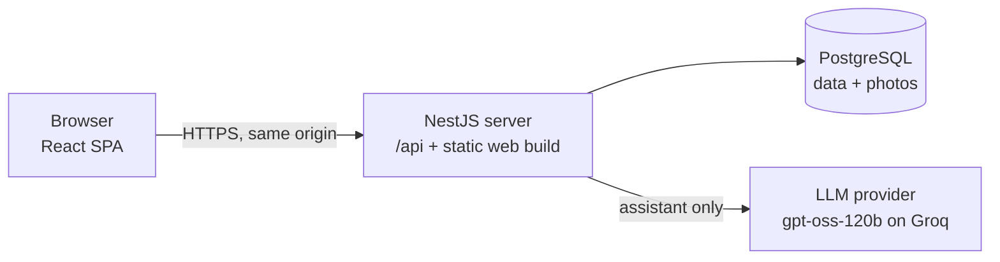
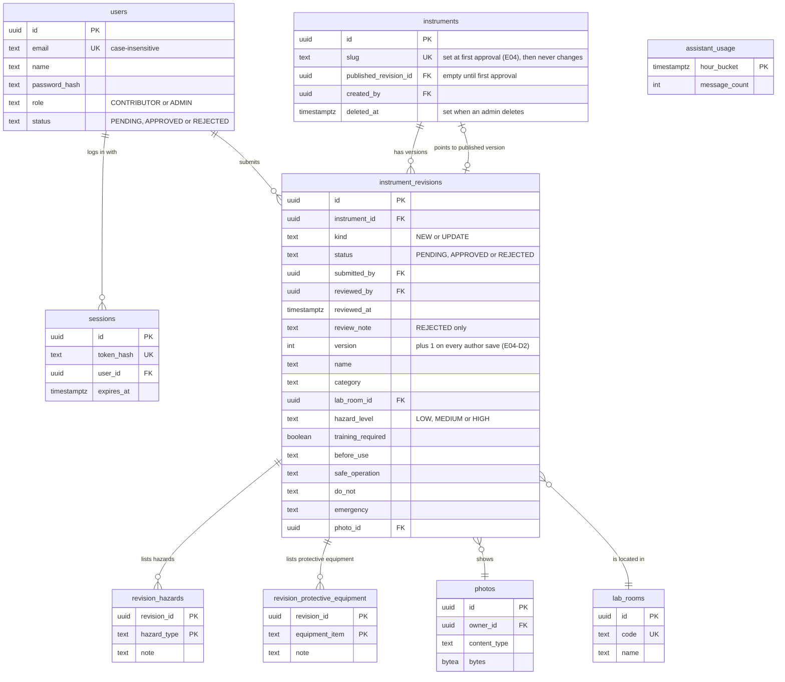
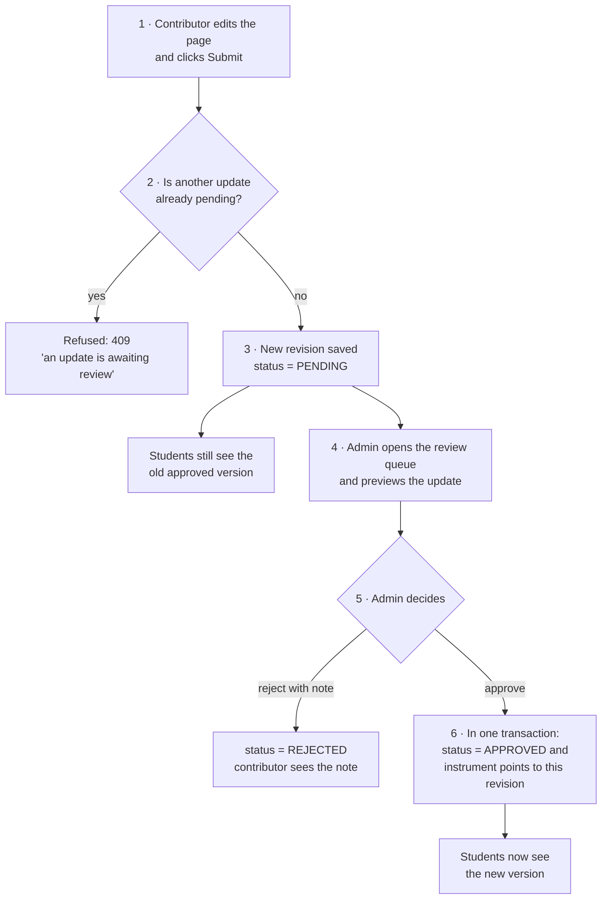
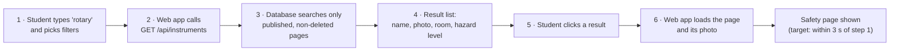
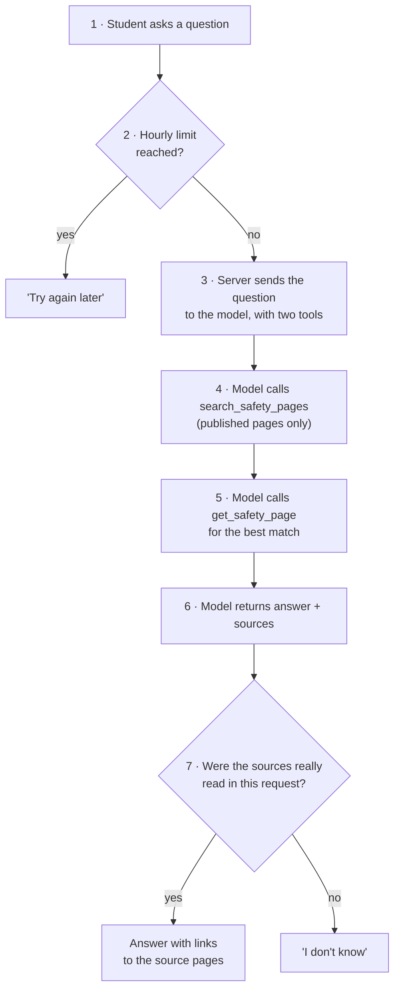

# LabSafe design doc

Implements [PRD](../prd/PRD.md). Every section traces to PRD requirement IDs; nothing speculative.

## 1. Architecture

There is one deployable unit: a NestJS server that serves the API under `/api` and the built React app for every other path. It talks to PostgreSQL and, for the assistant only, to an LLM provider.



| Environment | Web / API | Database | LLM |
| --- | --- | --- | --- |
| Development | Vite :5173 (proxies `/api`) and Nest :3000 | Docker `postgres:15`, port 5442 | fake by default, Groq optional |
| Test (`pnpm e2e`, `pnpm qa:serve`) | built app on :4100 | `labsafe_test`, port 5443 (tmpfs) | fake |
| Production (demo link) | Render free web service (Docker) | Neon free Postgres | Groq free tier |

## 2. Repo layout and layers

A pnpm workspace:

```
apps/api/         NestJS server
  src/modules/    auth · users · instruments (entities since E03; public reading since E04) · submissions · review · photos · assistant · meta
  src/common/     config, error filter, guards, Zod pipe
  src/db/         data source, migrations, seeds
  test/           backend integration tests (against labsafe_test)
apps/web/         React app (Vite)
  src/pages/      one folder per route
  src/components/ shared UI, including SafetyPageView
  src/api/        typed client built on the shared schemas
packages/shared/  Zod schemas (the API contract), fixed lists, error codes
e2e/              Playwright tests
docker-compose.yml · Dockerfile · .env.example
```

**Layer rules (API):** a controller (HTTP only: parse with a shared Zod schema, call the service, return its result) → a service (business rules, transactions) → TypeORM repositories. Controllers never touch repositories. Every public read of page content goes through one `PublishedInstrumentsQuery` (invariant I1).

**Layer rules (web):** a page component → a hook in `src/api` (TanStack Query) → `fetch`. The admin preview (US12) and the public page (US3, US4) render the same `SafetyPageView` component, so the preview really is what students will see.

The epic that sets up the code writes the detailed rules into `apps/api/CLAUDE.md` and `apps/web/CLAUDE.md`.

## 3. Domain model and invariants

**The key idea in one sentence:** an *instrument* is just an identity (its URL slug). Every version of its safety page is a separate *revision*, and the instrument points at the one revision students may see.

```
 INSTRUMENT "rotary-evaporator"
 └─ published_revision_id ──────────► REVISION 3  (APPROVED)   ◄── what students see
    REVISION 1  (APPROVED, older)
    REVISION 2  (REJECTED, with the admin's note)
    REVISION 4  (PENDING update)      ◄── only the contributor and admins see this
```



*(The diagram shows the main columns of `instrument_revisions`; the full list is below.)*

**Tables in plain words** (every `id` is a UUID; every time is a timestamp with time zone):

| Table | What one row is | Columns |
| --- | --- | --- |
| `users` | One account | email (unique, case-insensitive), name, password_hash, role, status |
| `sessions` | One logged-in browser | token_hash (unique), user_id, expires_at |
| `lab_rooms` | One room of the lab | code, name. Filled in by a migration with placeholder rooms (PRD §7) |
| `instruments` | One instrument's identity | slug (empty until the first approval, then never changes; lowercase with hyphens, unique, `-2`, `-3` … for a taken name; E03-D3, E04-D3), published_revision_id (set together with slug), created_by, deleted_at |
| `instrument_revisions` | One version of a safety page | *Workflow:* instrument_id, kind, status, submitted_by, submitted_at, reviewed_by, reviewed_at, review_note (only on a REJECTED revision), version (the admin approves the version they saw; E04-D2). *Content:* every field from PRD §4.1, listed in the next table |
| `revision_hazards` | One hazard on one version | revision_id, hazard_type, note |
| `revision_protective_equipment` | One protective-equipment item on one version | revision_id, equipment_item, note |
| `photos` | One uploaded photo | owner_id, content_type, bytes (the re-encoded image), width, height |
| `assistant_usage` | The assistant message count for one hour | hour_bucket (the UTC hour), message_count |

**Content columns of `instrument_revisions`, with their PRD field:**

| Column | PRD §4.1 field | Notes |
| --- | --- | --- |
| name, manufacturer, model, description | Identity | |
| category, lab_room_id | Category, lab room | Category from the fixed list; room via a foreign key |
| responsible_name, responsible_contact | Responsible person | |
| hazard_level | Hazard level | LOW, MEDIUM or HIGH |
| training_required, training_given_by | Training required before first use | Yes/no, and who gives it |
| no_significant_hazards | "No significant hazards" | True only when the contributor explicitly ticks this instead of listing hazards |
| standard_lab_attire_only | "No PPE beyond standard lab attire" | True only when the contributor explicitly ticks this instead of listing protective equipment |
| hazard_pictograms | GHS pictograms | A list of values from the 9 GHS symbols (GHS = Globally Harmonized System of hazard labels) |
| before_use, safe_operation, do_not, emergency | The four guideline sections | |
| emergency_phone | Emergency phone number | |
| emergency_equipment | Nearest emergency equipment | A small JSON object with all six keys (`EYEWASH`, `SAFETY_SHOWER`, `FIRE_EXTINGUISHER`, `SPILL_KIT`, `FIRST_AID_KIT`, `EMERGENCY_STOP`), each `{kind: LOCATION, location}` or `{kind: NOT_APPLICABLE}` |
| photo_id | Photo | |
| search_vector | (none) | Computed by the database for the assistant's full-text search; added by E06/E07, not by E03 |

Hazards and protective equipment get their own tables because students filter by them (US2). Emergency equipment is only displayed, so a JSON object is enough. Each epic's migration adds only the columns that epic writes (E03-D6): E03 created `photos`, `instruments` (without `slug`, `published_revision_id` and `deleted_at`), `instrument_revisions` (without the review columns and `search_vector`) and the two child tables. E04 added `slug` and `published_revision_id`, and `reviewed_by`, `reviewed_at`, `review_note` and `version` with the review CHECK (PENDING has no reviewer, date or note; APPROVED has reviewer and date; REJECTED also a non-blank note).

| # | Invariant | Requirement | Enforced by |
| --- | --- | --- | --- |
| I1 | The public sees only the published revision of a non-deleted instrument | R1, US8, US13 | All public reads go through `PublishedInstrumentsQuery`; integration tests act as an anonymous visitor (M3) |
| I2 | A published revision belongs to its instrument and is APPROVED | R1 | Composite foreign key `instruments (id, published_revision_id) → instrument_revisions (instrument_id, id)`; CHECK: slug and pointer both set or both empty; the approve transaction locks the revision, checks it is PENDING in the version the admin saw, and sets the status and the pointer together; `PublishedInstrumentsQuery` also filters APPROVED |
| I3 | At most one PENDING revision per instrument | R6 | Partial unique index on `instrument_revisions(instrument_id) WHERE status = 'PENDING'` |
| I4 | A submitted page has every required field | R3 | The shared Zod `SafetyPageContent` schema, for create and edit (lists every missing field, including "hazards ≥ 1 or no_significant_hazards, not both" and the same for protective equipment with standard_lab_attire_only); the service writes the revision and its child rows from the parsed body in one transaction; NOT NULL and non-empty CHECKs, and the training and emergency-equipment CHECKs |
| I5 | List values come only from the fixed lists | R4 | Constants in `packages/shared`; CHECK (value IN …) constraints generated from the same constants; lab rooms through a foreign key |
| I6 | Training required ⇒ hazard level is not LOW | R5 | Table CHECK constraint plus a Zod refinement |
| I7 | There is always at least one admin | US14 | Demotion in a transaction that locks the admin rows (`SELECT … FOR UPDATE`) and counts them |
| I8 | Only approved contributors and admins write content | US6, NFR4 | A guard that loads the user from the session on every request, so a new status or role takes effect immediately |
| I9 | A contributor edits only their own PENDING or REJECTED revisions | NFR4, US9 | A service check (`submitted_by = me`) under a row lock, returning 404 otherwise; the author of an APPROVED revision gets 409 `ALREADY_REVIEWED` (E04-D8); saving a REJECTED one resubmits it |
| I10 | AI messages per UTC hour never exceed the limit | R2 | An atomic `INSERT … ON CONFLICT DO UPDATE … WHERE message_count < limit RETURNING`; no row returned means the limit is reached |
| I11 | A photo is served only when its revision is published, or to its owner or an admin | R1 | A check in `PhotosService` before any bytes are streamed, asking `PublishedInstrumentsQuery` whether the photo is a published revision's; a replaced photo stays private (E04-D7) |

## 4. API surface

Everything is under `/api`. **Who may call:** Public = anyone; Signed-in = any session, whatever its status; Contributor = approved contributor or admin; Admin = approved admin.

**Auth and meta**

| Method | Path | Who may call | Purpose | Requirement |
| --- | --- | --- | --- | --- |
| POST | /auth/signup | Public | Create a PENDING contributor | US6 |
| POST | /auth/login | Public | Start a session (sets the cookie) | US6 |
| POST | /auth/logout | Signed-in | End the session | US6 |
| GET | /auth/me | Public | Current user, role, status; `{user: null}` for an anonymous visitor (E02-D3) | US6 |
| GET | /meta/lists | Public | Fixed lists and lab rooms | R4, US2 |

**Public reading and assistant**

| Method | Path | Who may call | Purpose | Requirement |
| --- | --- | --- | --- | --- |
| GET | /instruments | Public | Search (`q`) and filters (category, room, hazard, protective_equipment, hazard_level) | US1, US2 |
| GET | /instruments/:slug | Public | Published page; any slug that isn't published is 404 | US3, US4 |
| GET | /photos/:id | Public* | Photo bytes as `image/jpeg`, `Cache-Control: private, no-cache` (*I11 applies in the service; everyone else gets 404, E03-D4) | US3, US7, R1 |
| POST | /assistant/ask | Public | One question → answer, sources or "unknown" | US5, R2 |

**Contributor**

| Method | Path | Who may call | Purpose | Requirement |
| --- | --- | --- | --- | --- |
| POST | /photos | Contributor | Upload a photo (≤ 5 MB, JPEG or PNG; multipart field `photo`) → `{id, width, height}` | US7 |
| POST | /submissions | Contributor | New page, submitted as PENDING | US7, R3 |
| POST | /instruments/:slug/updates | Contributor | Suggest an update (a new PENDING revision) | US8, R6 |
| GET | /submissions/mine | Contributor | My submissions with status and note | US9 |
| GET | /submissions/:id | Public* | One submission (*the service allows the author and approved admins; everyone else gets 404, E03-D4) | US7, US9, US12 |
| PUT | /submissions/:id | Public* | Edit a PENDING revision (E03), or resubmit a REJECTED one: PENDING again with a new `submitted_at` and the note cleared (E04-D5) (*the service allows only the approved author, I9; the author of an APPROVED revision gets 409 `ALREADY_REVIEWED`; everyone else, admins included, gets 404, E03-D4) | US7, US9 |

**Admin**

| Method | Path | Who may call | Purpose | Requirement |
| --- | --- | --- | --- | --- |
| GET | /admin/users | Admin | Users with `status=PENDING` (oldest first) or `status=APPROVED` (by name) | US10, US14 |
| POST | /admin/users/:id/approve | Admin | Approve a sign-up | US10 |
| POST | /admin/users/:id/reject | Admin | Reject a sign-up | US10 |
| PUT | /admin/users/:id/role | Admin | Make or remove an admin (I7) | US14 |
| GET | /admin/review-queue | Admin | Pending new pages and updates, oldest `submitted_at` first | US11 |
| GET | /admin/submissions/:id | Admin | The preview: one submission of any status as `SafetyPageDisplay`, with its `version` (E04-D4) | US12 |
| POST | /admin/submissions/:id/approve | Admin | Publish the `version` the admin saw (I2, E04-D2) | US12 |
| POST | /admin/submissions/:id/reject | Admin | Reject; a note is required | US12 |
| DELETE | /admin/instruments/:slug | Admin | Soft delete (sets deleted_at) | US13 |

Request and response bodies are Zod schemas in `packages/shared`. Each epic's design names them. A route that is Public* at the guard decides in its service and answers 404 to every caller it doesn't allow, so the guard's 401 or 403 never reveals that unpublished content exists (E03-D4).

## 5. Auth and authorisation

- **Sign-up and login:** email and password. Passwords are hashed with Node's built-in `scrypt` (random salt, compared in constant time).
- **Session:** sign-up and login create a random 32-byte token. The browser keeps it in the `labsafe_session` cookie: `httpOnly`, `SameSite=Lax`, `Path=/`, and `Secure` when `COOKIE_SECURE` is true (default: only when `NODE_ENV=production`, because the test copy on :4100 is plain HTTP). The database keeps only its SHA-256 hash, valid for 7 days from login (not extended by use). Logout deletes the row.
- **Every request** loads the user from the session, so approving, rejecting or changing a role takes effect at the user's very next request (US10, US14).
- **Cross-site request forgery:** the app is served from one origin, the cookie is `SameSite=Lax`, and a global `RequestOriginGuard` refuses (403) every POST, PUT, PATCH or DELETE unless it carries `Content-Type: application/json` or `multipart/form-data` and, when an `Origin` header is present, its host equals the `Host` header. In development the Vite proxy keeps `Host` unchanged (`changeOrigin: false`) so the check passes.
- **Guards:** one global `AccessGuard` with four levels from `apps/api/src/common/access.ts`: `@Public()`, `@SignedIn()` (any session, used by logout), `@Contributor()` (status APPROVED, role CONTRIBUTOR or ADMIN) and `@Admin()` (status APPROVED, role ADMIN). A route with no decorator is refused with 403 for everyone. It runs after `RequestOriginGuard`.
- **The first admin** is created at start-up from `BOOTSTRAP_ADMIN_EMAIL`, `BOOTSTRAP_ADMIN_PASSWORD` and `BOOTSTRAP_ADMIN_NAME` when no admin exists (PRD §7). All three or none: a partial set stops the start-up with one line naming the missing settings; with none set and no admin, the app starts and logs a warning. If the email already has an account, that account becomes an approved admin and keeps its password (risk in §11). No other names are read (for example `SEED_ADMIN_*`).

| Role | Read and search, assistant | Write own submissions | Review, users, delete |
| --- | --- | --- | --- |
| Anonymous student | ✓ | – | – |
| PENDING or REJECTED account | ✓ | – | – |
| Approved contributor | ✓ | ✓ | – |
| Admin | ✓ | ✓ (and may approve their own) | ✓ |

## 6. Critical flows

Each flow is drawn as boxes and arrows. A numbered list follows it, so it can be read without the diagram too.

### 6.1 Suggest an update, then approve it (US8, US12, R1, R6)



1. The contributor edits a copy of the published page and submits it.
2. The database allows only one pending update per instrument (I3). If one exists, the request is refused.
3. The new revision is saved as PENDING. The instrument still points to the old approved revision, so students see no change.
4. The admin sees the update in the review queue and previews it exactly as students would.
5. Rejecting needs a note; the contributor sees it in "My submissions" and can fix and resubmit.
6. Approving changes the status and moves the instrument's pointer in the same transaction (I2), so there is never a moment where students see something unapproved.

### 6.2 Search, then open a page (US1 to US3, M1, M2)



1. The student types a search term and optionally ticks filters (category, room, hazard type, protective equipment, hazard level).
2. The web app sends one request with the term and filters.
3. The database matches name, manufacturer and model, ignoring case, and only among published, non-deleted pages (I1).
4. The results appear within 1 s (M2).
5. The student opens a result.
6. The page and its photo load; the whole journey is at most 3 s (M1).

### 6.3 Ask the assistant (US5, R2)



1. The student asks one question; there is no chat history.
2. The server adds 1 to this hour's message count (I10). If the limit is reached, the student sees "try again later".
3. The server sends the question to the model together with two tools.
4. The model searches the published pages with `search_safety_pages`.
5. The model reads the most relevant page with `get_safety_page` (at most 3 tool rounds in total).
6. The model replies with its answer and the pages it used.
7. The server keeps only sources that the model actually read during this request. If none remain, the answer becomes "I don't know". Every answer shows the "check the safety page" note.

## 7. Search · photo storage · AI assistant

**Search (US1, US2, NFR1).**
- Name search is PostgreSQL `ILIKE` on name, manufacturer and model, backed by a `pg_trgm` GIN index (case-insensitive substring match).
- Filters are `EXISTS` subqueries on `revision_hazards` and `revision_protective_equipment`, plus plain column filters for category, room and level.
- Only published revisions of non-deleted instruments are searched (I1).
- With about 100 instruments, this stays far below the 1 s target. No separate search engine is needed.

**Photos (US7, NFR5).**
- Uploads are limited to 5 MB and to JPEG or PNG, checked by reading the file's content, not trusting its stated type.
- `sharp` reads the format from the bytes (anything other than JPEG or PNG, or a file it can't decode, is 415 `PHOTO_TYPE`), then re-encodes each photo to JPEG: auto-rotated, at most 1600 px on its longer side and never enlarged, transparency flattened on white, quality 80, with no metadata, which removes EXIF data such as GPS coordinates (E03-D8). The result (about 200–400 KB) is stored in the `photos` table.
- A file over 5 MB is refused by multer's limit as 413 `PHOTO_TOO_LARGE`; the photo is uploaded on its own and the page refers to it by `photoId` (E03-D1).
- Photos are served with `Cache-Control: private, no-cache` and `X-Content-Type-Options: nosniff`, and only when I11 allows.
- Storing photos in the database keeps us within free hosting: Render's disk is wiped on restart, and Neon's 0.5 GB comfortably holds a few hundred re-encoded photos.

**AI assistant (US5, R2).**
- **Model:** the open-weight `openai/gpt-oss-120b` (Apache 2.0), served by Groq's free tier through its OpenAI-compatible Chat Completions API with tool calling.
- **Swappable:** the provider sits behind an `LlmProvider` interface. Base URL, model and key come from configuration, so OpenRouter or a local Ollama `gpt-oss-20b` can be swapped in without code changes.
- **One question at a time**, no history: the "librarian" from the brief. It has two tools:
  - `search_safety_pages(query)`: PostgreSQL full-text search (`websearch_to_tsquery`) over published revisions, returning at most 5 slugs and names.
  - `get_safety_page(slug)`: the published revision as compact text.
- **Limits:** at most 3 tool rounds per question.
- **Answer format:** the model must reply with JSON `{status: "answered" | "unknown", answer, sources: [slug]}`. The server drops any source that was not fetched with `get_safety_page` during this request. An "answered" reply with no remaining source becomes "unknown". The UI always adds the PRD's "check the page" note.
- **Errors:** a provider error, time-out (15 s) or provider rate limit returns the same "try again later" message as R2.
- **Tests:** a deterministic `FakeLlmProvider` (keyword rules that exercise both tools) is used by every automated test. `pnpm eval:assistant` runs the 20-question M6 check against the real provider; it is run by hand, not part of `pnpm verify`.

## 8. Error model

Every error response looks like this:

```json
{ "statusCode": 400, "code": "VALIDATION_FAILED", "message": "…", "fields": [{ "path": "hazards", "message": "Required" }] }
```

| Status | Code | When |
| --- | --- | --- |
| 400 | VALIDATION_FAILED | Zod validation failed; `fields` names every missing or invalid field (R3) |
| 401 | UNAUTHENTICATED · INVALID_CREDENTIALS | No session or an expired one · wrong email or password at login (one message for both) |
| 403 | FORBIDDEN | Wrong role, the account is not approved, the route declares no access level, or a data-changing request failed the origin check |
| 404 | NOT_FOUND | Missing, or not visible to this caller. Unpublished content is always a 404, never a 403, so its existence is not revealed (R1) |
| 409 | PENDING_UPDATE_EXISTS · LAST_ADMIN · EMAIL_TAKEN · USER_NOT_PENDING · USER_NOT_APPROVED · ALREADY_REVIEWED · SUBMISSION_CHANGED | I3, I7, sign-up, approving or rejecting an account that is no longer pending, changing the role of an account that is not approved, approving or rejecting a page that is no longer pending (or the author saving an approved one), approving a page the author changed since the preview |
| 413 / 415 | PHOTO_TOO_LARGE · PHOTO_TYPE | Photo upload over 5 MB · content not a JPEG or PNG (E03). A request without a file is 400 `VALIDATION_FAILED` on `photo`; the JSON body parser's 413 stays `REQUEST_REJECTED` |
| 429 | ASSISTANT_BUSY | R2 limit reached, or the provider is unavailable |

The error codes are a shared enum in `packages/shared`. E01 also defines 503 `SERVICE_UNAVAILABLE` (health check), `REQUEST_REJECTED` (any other client error that has no specific code yet, with a generic message) and 500 `INTERNAL_ERROR`. The global Nest exception filter keeps a client error's 4xx status only for an `HttpException` or an Express request error with `expose === true` (for example the body parser's 413); everything else, including another library's error that carries a 4xx `status`, becomes 500 `INTERNAL_ERROR` with no internal details.

## 9. Testing strategy and the tooling contract

| Level | Tool | Covers |
| --- | --- | --- |
| Unit | Vitest | Pure rules: Zod schemas (R3, R5), slugs, hour buckets, assistant source checks |
| Backend integration (`auto: api`) | Vitest + Supertest + Nest app on `labsafe_test` | Every endpoint; the role matrix for each role that must be refused (NFR4); anonymous leak tests (M3); I2, I3, I7, I10 under real constraints |
| Web component (`auto: web`) | Vitest + Testing Library + MSW | Forms, loading, empty and error states, filters |
| End-to-end (`auto: e2e`) | Playwright against the built app on :4100 | User journeys at 375 px and desktop width; the timed M1 and M2 test |
| Manual / on demand | Lighthouse, `pnpm eval:assistant` | M5, M6 |

Each automated test's title starts with its story and acceptance criterion, for example `it('S02.1 AC2 refuses a non-admin with 403', …)`, so the documentation check can trace it. E01's tests keep their `TC-…` titles.

**How each required command is provided:**

| Command | What it runs |
| --- | --- |
| `pnpm db:up` | `docker compose up -d --wait db db-test` (`postgres:15`; dev on 5442 with a volume, `labsafe_test` on 5443 on tmpfs) |
| `pnpm dev` | `concurrently`: shared `tsup --watch`, Nest watch on :3000 (loads the repository-root `.env`), Vite on :5173 (proxies `/api`) |
| `pnpm typecheck` | build `@labsafe/shared`, then `tsc --noEmit` in every package |
| `pnpm verify` | prettier check → eslint → typecheck → unit and web tests → backend integration tests → build → docs:check |
| `pnpm e2e` | build → reset `labsafe_test` and run migrations (`test:db:prepare`; later epics add the e2e seed here) → Playwright starts the built app on :4100 with `e2e/test-env.ts`, whose `BOOTSTRAP_ADMIN_*` values give the fresh copy one setup admin (later epics set `AI_PROVIDER=fake` in test env) |
| `pnpm qa:serve` | build → `test:db:prepare` → start the built app on :4100 with the same test settings as e2e, print `QA server: http://localhost:4100`, keep running |
| `pnpm docs:check` | `node .claude/tools/docs-check.mjs` |

Extra scripts: `db:migrate` and `db:seed` (development database; each run needs the user's approval) and `eval:assistant`. `pnpm verify`, `pnpm e2e` and `pnpm qa:serve` all use `labsafe_test`, so they never run at the same time. Every command that resets `labsafe_test` goes through one guard that accepts only database `labsafe_test` on port 5443 of `localhost` / `127.0.0.1`, with no query string or hash (E01 design §6).

## 10. Environments, ports, configuration

- **Ports:** development database 5442, test database 5443, API (dev) 3000, Vite (dev) 5173, test app 4100. Port 5432 is never used (another project uses it).
- **Configuration:** environment variables, validated by a Zod schema at start-up, which fails fast on a bad value. `.env.example` lists them, and `.env` is never committed or read by agents.
  - `DATABASE_URL`, `PORT`, `NODE_ENV`, `WEB_DIST_DIR` (test and production only), `COOKIE_SECURE` (`true` or `false`; unset means true only in production)
  - `AI_PROVIDER` (`fake` | `openai-compatible`), `AI_BASE_URL`, `AI_API_KEY`, `AI_MODEL` (default `openai/gpt-oss-120b`), `AI_HOURLY_LIMIT` (default 100)
  - `BOOTSTRAP_ADMIN_EMAIL`, `BOOTSTRAP_ADMIN_PASSWORD`, `BOOTSTRAP_ADMIN_NAME`: all three or none, each checked with the sign-up rules (§5)
- **Production:**
  - A multi-stage `Dockerfile` builds web and API into one Node 24 image. Render runs it as a free web service and deploys automatically when `master` is pushed. At start-up the container runs the migrations, then starts the server.
  - Neon free Postgres 15 is used with `sslmode=require`. The secrets live in Render's environment settings.
- **Schema changes** happen only through TypeORM migration files (`synchronize: false`).

## 11. Risks

| Risk | Effect | Mitigation |
| --- | --- | --- |
| Render free service sleeps after 15 minutes idle; waking takes about 1 minute | The first visit to the demo link is slow. M1 is measured on the local test stack (PRD §5), so the metric itself is not affected | Open the link a minute before a demo. The image is portable, so moving to another host only needs a configuration change |
| Groq free-tier limits (about 30 requests/minute, 8K tokens/minute, 1K requests/day; check console.groq.com) | Sustained assistant use can hit the provider limit before our R2 limit does | Provider 429 is shown as "try again later". Keep the tool output compact. Lower `AI_HOURLY_LIMIT` for the demo, or change the provider by configuration |
| The model calls tools wrongly or cites something it did not read | Wrong safety advice (the PRD's top risk) | Sources are verified on the server; anything unverified falls back to "unknown"; M6 is measured before release |
| Free-tier terms change (Render, Neon, Groq) | The demo link breaks | Everything is configuration plus one Docker image and plain Postgres; no vendor-specific features |
| `sharp` is a native dependency | Install trouble with pnpm 11 | Approve it in `allowBuilds:` in `pnpm-workspace.yaml`; it ships prebuilt binaries for macOS and Linux |
| Neon storage of 0.5 GB | The photos table fills up | Re-encoding keeps each photo around 300 KB; the PRD assumes at most about 100 instruments |
| While no admin exists, anyone may sign up with the address later put in `BOOTSTRAP_ADMIN_EMAIL` (there is no email verification) | At the next start that account becomes admin with its own password | Set the three `BOOTSTRAP_ADMIN_*` settings before the first public start (E08), with a password of your own, never the `.env.example` placeholder |

## 12. Decisions

| # | Decision | Why | Alternatives considered | Date |
| --- | --- | --- | --- | --- |
| D1 | pnpm monorepo: `apps/api`, `apps/web`, `packages/shared`, `e2e` | One repo, one shared contract, one `pnpm verify` | Separate repos | 2026-10-29 |
| D2 | Contract-first: Zod schemas in `packages/shared`, used by API validation, web forms and MSW mocks | Backend and frontend tickets can't drift apart; R3 errors list the exact fields | OpenAPI codegen; class-validator DTOs | 2026-10-29 |
| D3 | Revision model: page content lives only in `instrument_revisions`, and public reads only follow `published_revision_id` | Makes R1 and US8 a data invariant, not a UI convention | Draft and live columns on one row; a status flag on the page | 2026-10-29 |
| D4 | TypeORM with migrations only, on PostgreSQL 15 | The agents are set up for TypeORM; `postgres:15` is already downloaded and Docker Hub may be unreachable | Prisma, Drizzle; Postgres 16+ | 2026-10-29 |
| D5 | Server-side sessions: an opaque token in an httpOnly cookie, hashed in the database | Approving a user, rejecting one or changing a role takes effect immediately (US10, US14); simple logout | JWT (stale role until it expires) | 2026-10-29 |
| D6 | Password hashing with Node's built-in `scrypt` | Secure, and no native build to approve | argon2, bcrypt | 2026-10-29 |
| D7 | One origin: Nest serves the built SPA in test and production; Vite proxies in development | No CORS, a simple cookie and CSRF setup, one deployable unit | Separate web and API hosts | 2026-10-29 |
| D8 | React SPA with Vite, React Router, TanStack Query, Tailwind CSS and react-hook-form | Fast client navigation for M1; little to learn | Next.js (server rendering is not needed, and it is heavier to host) | 2026-10-29 |
| D9 | Search inside PostgreSQL: `pg_trgm` for name search, full-text search for the assistant | Meets NFR1 at our scale with nothing extra to host | Meilisearch or Elasticsearch; embeddings with pgvector (not in the local `postgres:15` image) | 2026-10-29 |
| D10 | Photos re-encoded with `sharp` and stored in PostgreSQL (`bytea`) | Free hosting has no persistent disk; removes EXIF and GPS data (NFR5); small enough for Neon free | Local disk (lost on Render); S3 or R2 (another account and its secrets) | 2026-10-29 |
| D11 | Open-weight `gpt-oss-120b` on Groq's free tier through an OpenAI-compatible API, behind `LlmProvider`, with `FakeLlmProvider` in tests | The user asked for an open-source model with tool use at no cost; one configuration change switches to OpenRouter or Ollama | Claude or OpenAI (paid, not open source); self-hosted Ollama (no free hosting can run it) | 2026-10-29 |
| D12 | The assistant is a single-question, tool-using librarian (`search_safety_pages`, `get_safety_page`, at most 3 rounds) and its sources are verified on the server | The user chose single questions; grounded answers (US5) that can be measured (M6) | Sending all pages in the prompt; chat history | 2026-10-29 |
| D13 | Hosting: Render free web service (Docker) plus Neon free Postgres | A free, shareable link; Neon's free database does not expire, while Render's free Postgres does after 30 days | Koyeb, Railway (no lasting free tier); Supabase (pauses after a week idle) | 2026-10-29 |
| D14 | Testing: Vitest everywhere (API through `unplugin-swc`), Supertest, MSW, Playwright; test titles start with their story and acceptance criterion (`S02.1 AC2 …`; E01 kept `TC-…` ids) | One test runner, and traceability that the docs check can verify | Jest for the API | 2026-10-29 |
| D15 | Fixed lists are TypeScript constants in `packages/shared`, mirrored by CHECK constraints; lab rooms are a seeded table | R4 is enforced in one place for code and database; rooms need display names | Postgres enum types (harder to change); lookup tables for every list | 2026-10-29 |

## 13. Changes

- **2026-10-30** (E01 `/epic-done`): §9 tooling table aligned with the built root scripts — `db:up` uses `--wait`, `typecheck` builds shared first, `dev` loads `.env` from the repository root, and `pnpm e2e` / `pnpm qa:serve` run **build → `test:db:prepare`** (not reset-then-build). E01 has no e2e seed or assistant env yet; those steps are noted for later epics.
- **2026-11-16** (E01 design update after the fixes of epic-review F1, F2): §8 names the E01 codes (`SERVICE_UNAVAILABLE`, `REQUEST_REJECTED`, `INTERNAL_ERROR`) and says a non-`HttpException` error keeps its 4xx status only with `expose === true`; §9 adds `pnpm qa:serve` to the commands that share `labsafe_test` and describes the test-database guard (no `?`/`#`, `localhost`/`127.0.0.1` only, `labsafe_test`, port 5443).
- **2026-11-24** (E02 `/complete-epic`): §4 `GET /auth/me` is Public and answers `{user: null}` to an anonymous visitor (E02-D3); Signed-in means any status, Admin an approved admin; `GET /admin/users` names its two `status` values. §5 describes what was built: the `labsafe_session` cookie with `Secure` from `COOKIE_SECURE`, the `RequestOriginGuard` rule and the dev proxy, the four access levels including `@SignedIn()`, and the first admin from `BOOTSTRAP_ADMIN_*` (all three or none; `SEED_ADMIN_*` is not read). §8 adds `INVALID_CREDENTIALS`, `USER_NOT_PENDING`, `USER_NOT_APPROVED` and the other 403 causes. §9 and D14: test titles use story and criterion since E02; `pnpm e2e` starts with a setup admin. §10 adds `WEB_DIST_DIR` and the `COOKIE_SECURE` and `BOOTSTRAP_ADMIN_*` rules. §11 adds the first-sign-up risk of `BOOTSTRAP_ADMIN_EMAIL` (S02.2 review F3).
- **2026-11-25** (E03 `/complete-epic`): §2 `instruments` holds only entities so far. §3 `slug` is empty until the first approval and then never changes (E03-D3); each epic adds only the columns it writes (E03-D6), so `search_vector` comes with E06/E07; the shape of `emergency_equipment`; I4 says where completeness is enforced as built (the shared `SafetyPageContent` schema, the transaction from the parsed body, the CHECKs). §4: `GET` and `PUT /submissions/:id` and `GET /photos/:id` are Public at the guard and decided by the service with 404 for everyone else (E03-D4); `POST /photos` names its field and response. §7 "Photos": the format check, the E03-D8 re-encoding and the served headers. §8: when `PHOTO_TOO_LARGE` and `PHOTO_TYPE` apply, the 400 without a file, and that the body parser's 413 stays `REQUEST_REJECTED`.
- **2026-11-26** (E04 `/complete-epic`): §2 `instruments` is a real module with the public read. §3 the diagram and tables add `reviewed_at`, `version` and the slug rules; the E04 columns and the review CHECK; I2 names the composite key as built (`instruments (id, published_revision_id)`), the published CHECK and the version check; I9 the 409 for an approved page (E04-D8) and the resubmission; I11 the published-photo check (E04-D7). §4 adds `GET /admin/submissions/:id` (E04-D4), says approve publishes the version seen (E04-D2) and what `PUT /submissions/:id` does with a rejected or approved page. §8 adds `ALREADY_REVIEWED` and `SUBMISSION_CHANGED`.
